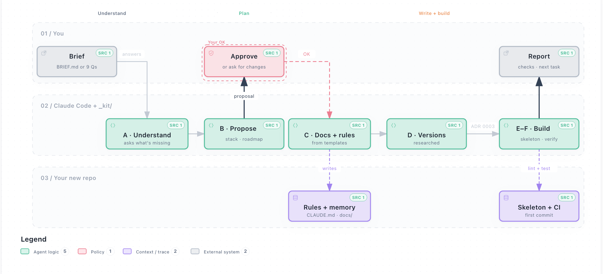

# How it works

repo-seed is a folder of Markdown templates plus one long prompt, [`SETUP_PROMPT.txt`](../SETUP_PROMPT.txt).
You copy the kit into an empty project folder as `_kit/`, open Claude Code there, and paste the prompt. Claude Code
then works through six phases, A to F, in order. It stops twice for you, writes no feature code, and finishes with an
empty-but-working project and a first commit.

<picture>
  <source media="(prefers-color-scheme: dark)" srcset="diagrams/setup-flow-dark.png"/>
  
</picture>

<sub>[Interactive version](diagrams/setup-flow.html) — download and open it in a browser to trace paths and jump to the
prompt lines behind each step. Made with [Archify](https://github.com/tt-a1i/archify), styled with the [repo-polish](https://github.com/Aryan-yadav15/repo-polish) Archify theme.</sub>

## The six phases

| Phase | What Claude Code does | Waits for you? | Prompt lines |
|---|---|---|---|
| **A · Understand** | Reads `_kit/BRIEF.md` if you wrote one and asks only about gaps; otherwise asks 9 numbered questions in one message: name and pitch, audience, platforms, v1 and later features, external services, stack constraints, UI feel, legal/privacy, timeline. | yes — your answers | [6–18](../SETUP_PROMPT.txt#L6-L18) |
| **B · Propose** | Recommends a stack per part (from `stacks/` where one fits, with one rejected alternative each), a 2-level repo layout, the gateway domains your external services need, a phased roadmap with the riskiest unknown first, and the risks. | yes — your OK or changes | [21–29](../SETUP_PROMPT.txt#L21-L29) |
| **C · Docs & rules** | Fills `docs/PLAN.md`, the root `CLAUDE.md` and one `CLAUDE.md` per part, `DESIGN.md` (UI projects only), `PROGRESS.md`, `INCIDENTS.md`, the first ADRs, and copies `.claude/` and `scripts/` with permissions and hooks adapted to your stacks. | no | [32–41](../SETUP_PROMPT.txt#L32-L41) |
| **D · Versions** | Finds the newest set of versions that are officially compatible with each other — from registries and release notes, not memory — and records the matrix and upgrade triggers in ADR 0003. | no | [43–46](../SETUP_PROMPT.txt#L43-L46) |
| **E · Skeleton** | Build files, lockfiles, package structure, core primitives only (Result and error types, logger, clock, fail-fast config, health endpoint or app shell), lint/format/type/boundary rules from each stack's "Enforced rules" table with messages that name the fix, one real test per part, root files (README, CHANGELOG, `.gitignore`, `.env.example`, Makefile with `make check`, `.suppressions-baseline`, pre-commit with gitleaks) and a CI workflow per part plus CODEOWNERS for the gate configs. | no | [48–57](../SETUP_PROMPT.txt#L48-L57) |
| **F · Verify & finish** | Runs `make check` and fixes the skeleton — never the rules — until green; proves each check catches a throwaway violation with a message that names the fix; deletes `_kit/`; `git init` on `main` and commits; updates PROGRESS; reports. | no | [59–73](../SETUP_PROMPT.txt#L59-L73) |

## What you get

```
CLAUDE.md                 the rulebook, filled in for this project (see rulebook.md)
<part>/CLAUDE.md          stack rules per deployable part (app/, server/, web/…)
docs/
  PLAN.md                 what you're building: users, features, gateways, data, roadmap, risks
  DESIGN.md               design system and motion rules (UI projects only)
  PROGRESS.md             where things stand: snapshot, phase tracker, inventory, session log
  INCIDENTS.md            what broke, and the lessons to read before touching that area
  adr/                    0001 architecture, 0002 gateway pattern, 0003 versions, one per stack choice
.claude/
  settings.json           allowed commands, files the agent may not read (.env, keys), configs it must ask to edit, the hooks
  commands/               /start-session /end-session /plan-feature /new-provider /new-screen /log-incident /new-adr
  agents/                 architecture-, security-, ui-reviewer and test-writer
  hooks/post-edit-lint.sh formats and lints each file Claude edits
  hooks/stop-check.sh     runs make check before Claude ends a turn
scripts/check-rules.sh    TODOs link an issue; suppressions can't grow past .suppressions-baseline
.github/                  workflows/ci-<part>.yml (lint, types, boundaries, rules, tests, build) · CODEOWNERS
Makefile · README.md · CHANGELOG.md · .env.example · .gitignore · .pre-commit-config.yaml · .suppressions-baseline
```

## The report at the end

Phase F ends with the final tree, a table of every check and its result (and which throwaway violation it caught), **every decision Claude made on its own,
flagged as an assumption**, a checklist of what you must do by hand (accounts, API keys, devices, installs, branch protection), and the
first task of the next phase. Then it stops. Restart Claude Code in the project root and continue with
[daily use](daily-use.md).

## Things to know

- **It's written for Claude Code.** The slash commands, agents, hook and `@docs/…` imports use Claude Code's `.claude/`
  conventions. Other agents can still follow `CLAUDE.md` and the docs as plain instructions, but won't get the commands,
  agents or hooks. `make check`, pre-commit and CI still hold them to the same rules.
- **Setup takes a while.** Phase D researches real package registries and Phase F loops until `make check` passes.
- **`_kit/` is removed at the end** ([prompt line 63](../SETUP_PROMPT.txt#L63)) unless you say otherwise. Keep your master copy of the kit
  somewhere permanent.
- **Nothing is pushed.** Setup makes a local commit only.
